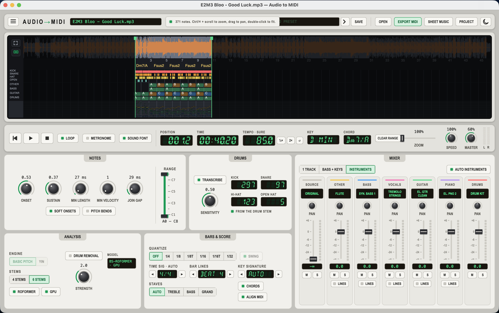
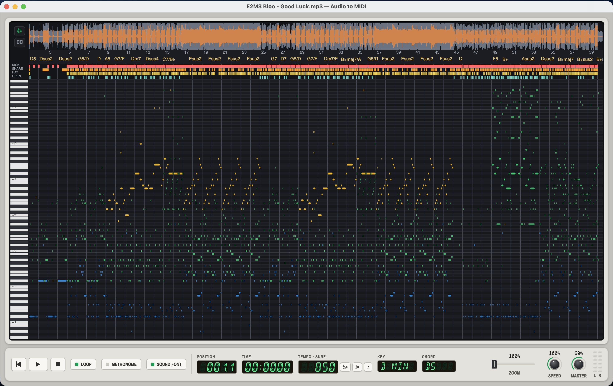

# Audio to MIDI

Audio to MIDI is a desktop app and command-line tool for turning a recording into MIDI and sheet
music. Open an audio or video file and the app will find the notes, the beat, the bar lines, the key
and the chords. You can then play the result back, adjust it by ear, and export it as a MIDI file, a
MusicXML score or a project folder. It can also write a drum track with kick, snare and hi-hats.

The app runs on macOS and Windows.



| Project | Purpose |
|---|---|
| `src/AudioToMidi.App` | Desktop app |
| `src/AudioToMidi.Cli` | `audio2midi` command-line tool for batch work |
| `src/AudioToMidi.Core` | Audio analysis and transcription |
| `src/AudioToMidi.Model` | Project folder format, for use in other apps |
| `tests/AudioToMidi.Tests` | Tests |

## Build

You need the [.NET 10 SDK](https://dotnet.microsoft.com/download) and ffmpeg. Install ffmpeg with
`brew install ffmpeg` on macOS or `winget install ffmpeg` on Windows. The app will look for it on your
`PATH` and in the usual install folders, and you can also set its location in the app. Without
ffmpeg, the app can still open `.wav` files.

```bash
dotnet build
dotnet test
dotnet run --project src/AudioToMidi.App
dotnet run --project src/AudioToMidi.Cli -- --help
```

To build a single-file app that runs on a machine without .NET:

```bash
dotnet publish src/AudioToMidi.App -c Release -r osx-arm64 --self-contained -p:PublishSingleFile=true -p:IncludeNativeLibrariesForSelfExtract=true -o publish/osx-arm64
dotnet publish src/AudioToMidi.App -c Release -r win-x64 --self-contained -p:PublishSingleFile=true -p:IncludeNativeLibrariesForSelfExtract=true -o publish/win-x64
```

Use `osx-x64` for Intel Macs. To ship ffmpeg with the app, place the ffmpeg binary next to the
published executable.

## Instrument separation

With the default settings, all pitched notes go on one track, or on a bass track and a keys track.
To give each instrument its own track, the app uses a separation model to split the recording into
stems such as bass, vocals, guitar and piano before it listens for notes. The models are a separate
download, since each one comes with its own licence (see [models/LICENSES.md](models/LICENSES.md)).



| Stems setting | Model | Tracks | Download |
|---|---|---|---|
| 4 | [HT-Demucs](https://huggingface.co/StemSplitio/htdemucs-onnx) | Bass, Vocals, Other | 166 MB |
| 6 | [HT-Demucs 6-source](https://huggingface.co/StemSplitio/htdemucs-6s-onnx) | Bass, Vocals, Guitar, Piano, Other | 136 MB |
| 6 | [BS-RoFormer SW](https://huggingface.co/elicwhite/bs-roformer-sw-6stem-onnx) | Bass, Vocals, Guitar, Piano, Other | 353 MB |

HT-Demucs takes about 15 to 20 seconds per minute of audio. BS-RoFormer gives the cleanest split,
especially for guitar, and on macOS it runs on the GPU at about the same speed. The first GPU run
needs around 12 seconds of extra setup, and the app keeps the result in
`~/Library/Caches/AudioToMidi/coreml` for later runs. Orchestral instruments such as strings, brass
and woodwinds all stay together in Other.

### Install a model

In the app, open the menu (≡) and pick a download button. From the command line:

```bash
audio2midi --download-model 4          # or 6, or roformer
```

Models go to `~/Library/Application Support/AudioToMidi/models` on macOS and
`%LOCALAPPDATA%\AudioToMidi\models` on Windows. To install from your own copy, use **Download from**
in the menu, or `--from` on the command line, with a path or URL to the `.onnx` file, a `.zip`
archive of models, or a folder that holds them:

```bash
audio2midi --download-model 6 --from ~/Downloads/AudioToMidi-models.zip
```

### Use a model

In the app, set **Tracks** to *Separate instruments* and choose the number of **Stems** in the
Analysis panel. With 6 stems, the app will use BS-RoFormer once it is installed; switch **ROFORMER**
off to go back to HT-Demucs, and switch **GPU** off to run on the CPU.

```bash
audio2midi song.mp3 --tracks instruments --stems 6
audio2midi song.mp3 --tracks instruments --stems 6 --no-roformer
audio2midi song.mp3 --tracks instruments --stems roformer --cpu
```

### What else a model unlocks

- **Instrument recognition.** With **AUTO INSTRUMENTS** on in the mixer, the app listens to each stem
  and picks the closest General MIDI instrument for its track, such as Electric Bass, Clavinet or
  Brass. Hover over a track's instrument to see other likely matches, or click it to choose your
  own; the app will remember your choice for that file. The instrument name also goes into the MIDI
  track name, which helps in apps that ignore General MIDI programs.
- **Cleaner drums.** Turn on **TRANSCRIBE** in the Drums panel (`--drums`). With a model installed,
  the drum track comes from the separated drum stem, with far fewer false hits from piano and guitar
  attacks. **SENSITIVITY** sets the balance between catching quiet hits and adding false ones.
- **Melody, harmony and low line.** A busy stem, such as a whole orchestra in Other or both hands of
  a piano, can split into a top line, a low line and the notes in between. Tick *Split into melody,
  harmony and low line* on a track, or use `--split-lines=other,piano`. In sheet music the melody
  goes on a treble staff and the low line on a bass staff.

### Pitch bends

The note model also tracks how each note's pitch moves, so it can catch bends and slides on guitar,
voice and lead synths. Turn on **PITCH BENDS** in the Notes panel (`--pitch-bends`) to show bends in
the piano roll, play them back and write them to MIDI. The result is rough, so listen before you
keep the bends in an exported file.

## Licences

The basic-pitch note model and the YAMNet sound model come built into the app under the Apache 2.0
licence. The separation models and SoundFonts come with their own terms. See
[models/LICENSES.md](models/LICENSES.md) for details.
